# JetSetGO! - A RC high wing, bi-propellor trainer plane

## Journal 1 — BUILDING MY FIRST RC AIRCRAFT!

Time spent : 1 hour 20 minutes

Deciding the basic design.

From a long time, I was fascinated by seeing rc trainers online, so I wanted to build one and I decided why not for expedition!

So I went off researching about different aircrafts for beginners, mostly YouTube and internet surfing

Since this was my first aircraft, the most beginner friendly one I found is a standard high wing rc trainer.

But I was not satisfied by that so after some more research and going through different innovative designs, I decided to build a bi-propellor.

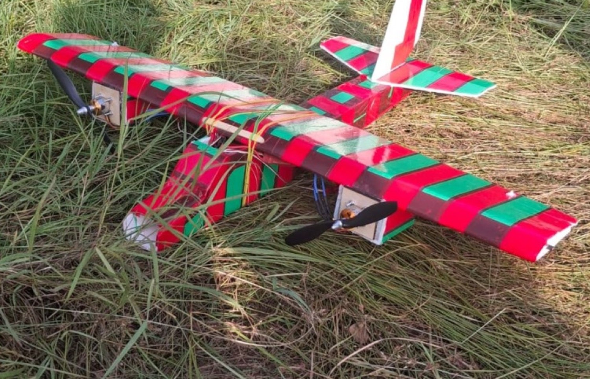

This was my inspiration which I found on the internet.

## Journal 2 — Research and concept

Time spent :  3 hours 15 minutes     (1 hour for wings, 2 hours 15 minutes for tail, fuselage and nose)

The concept is a twin-motor high-wing trainer, next was researching for wings, tails, fins e.t.c

After going through random YouTube videos and some websites, what I finalised was -

A. Wings- Armin folded wing with two counter-rotating motors in pods under the wing.

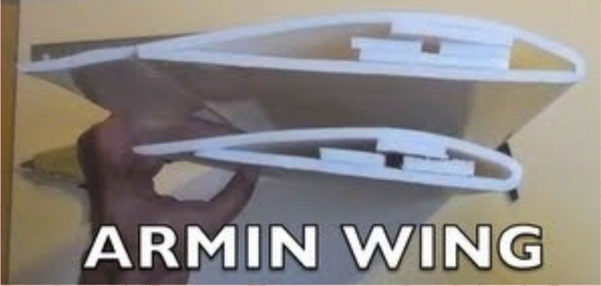

B. TAIL AND FINS - inspired from my childhood favourite V22 Osprey style H tail

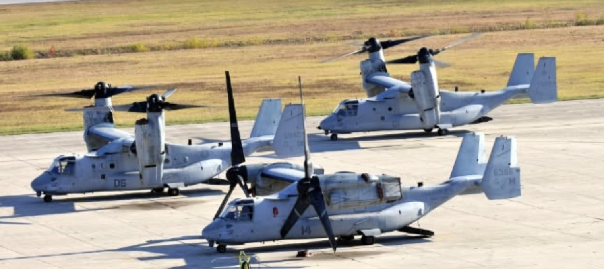

C.NOSE - a square-pyramid nose, since there is no motor on the nose, a simple square pyramid nose does the job!

D.FUSELAGE - I was tired researching for wings, tail and nose so I decided to go on with a simple back tapered fuselage

## Journal 3 — Studying basics of aerodynamics

Time spent : 3 hour 10 minutes

While surfing through internet for finalising the designs and completing the concept, I realised that I can’t randomly attach any part anywhere as I wish, everything needs to be planned to make it aerodynamically more efficient.

Carelessly if I make one side of the wing slightly heavy or shift the CG, the game is over!

This also sparked an interest in me which made me study basics of aerodynamics and making a rc trainer

I studied about 2 hours 10 minutes , which I will try my best to further summarise below so someone with zero experience in aviation could understand the basics and reciprocate, also from this point I will be directly using those terminology

3.1) forces on an airplane -

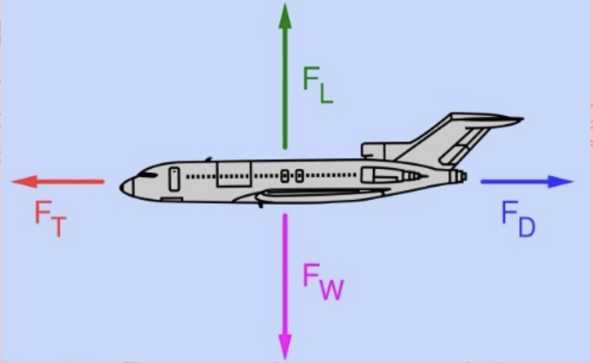

The negative forces are the drag and the weight, plane counters it by Thrust for Drag and lift for weight

3.2) Airfoil and lift generation-

How is the lift generated? Something special about the wings?

Airfoil -

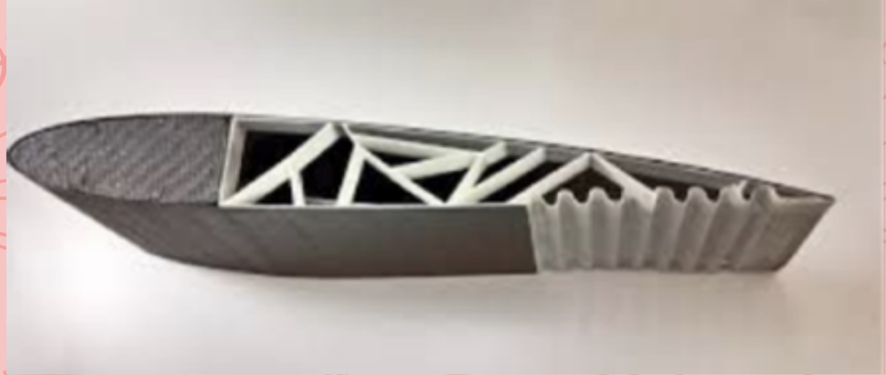

The cross section of the wing and its peculiar shape is in order to generate lift

Aerodynamic characteristics vary greatly with airfoil shape

Lift generation-

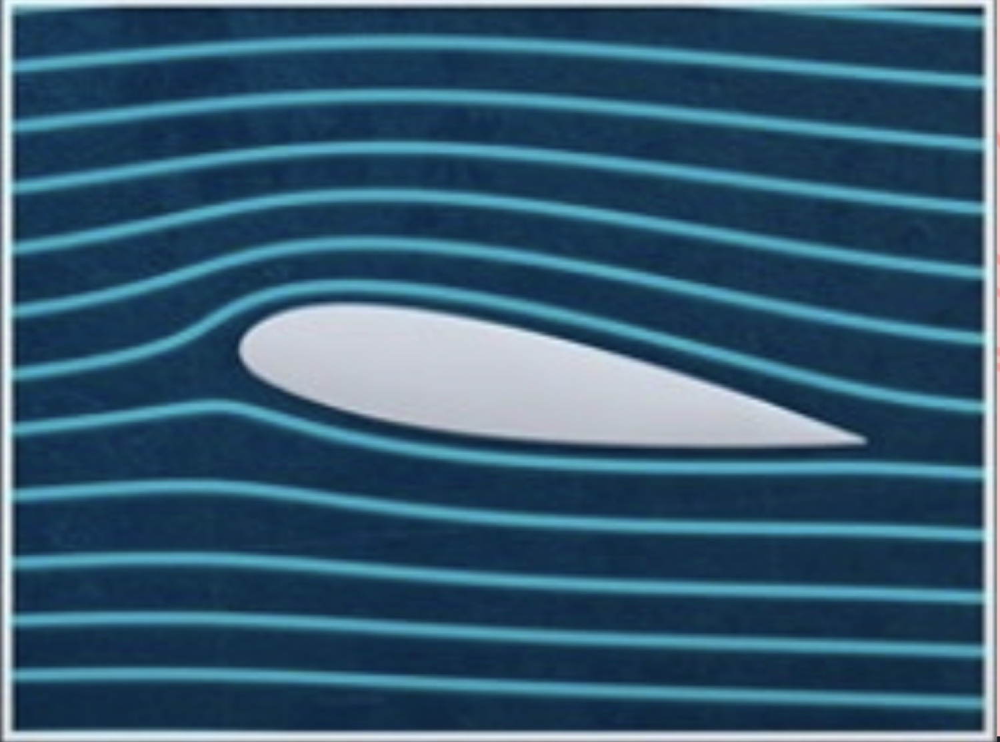

Due to the peculiar shape of the airfoil, a curvature is induced in the incoming airflow. Due to the asymmetry in this curvature on the top and bottom parts of the wing, a net upward lift is generated.

Some more physics, the lift equation

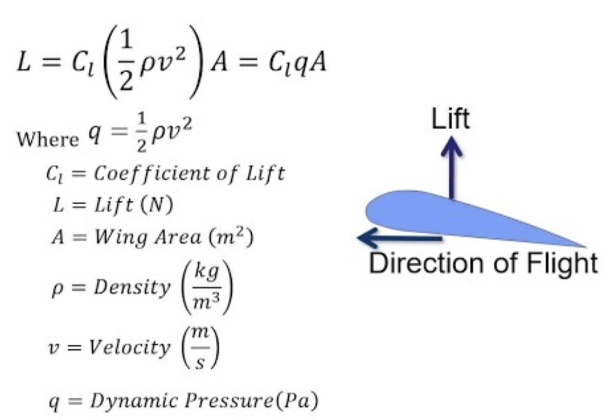

## Journal 4 — Anatomy of the plane -

Time spent : 3.8 hours

4.1) The parts -

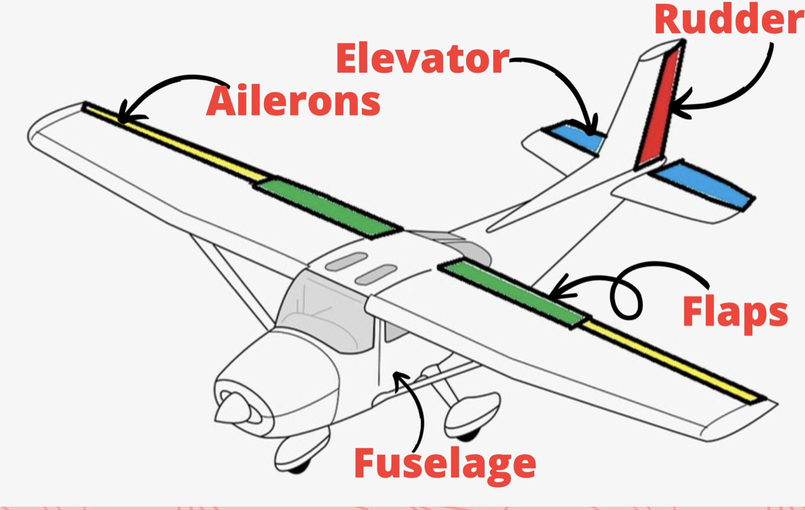

4.2) Aircraft principal axis -

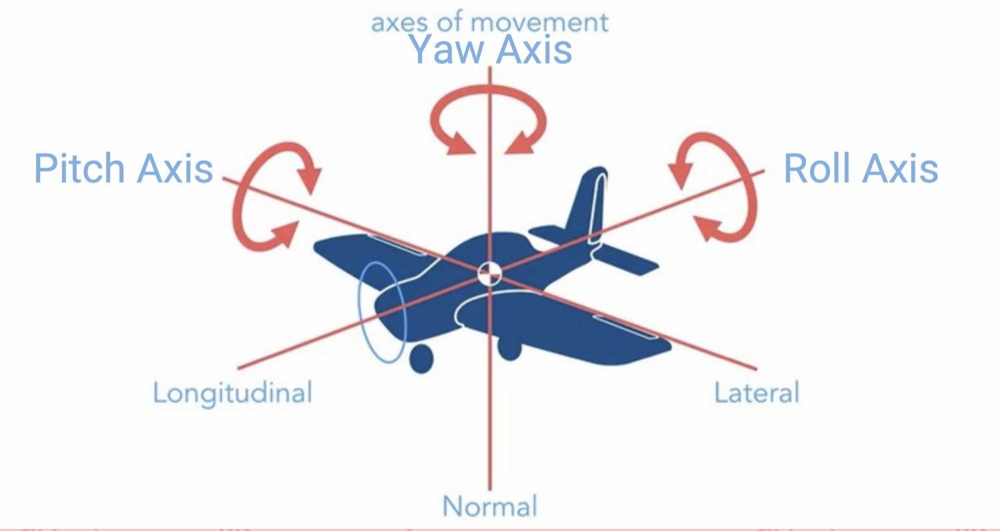

So how the movement in each axes controlled?

~roll motion due to the movement of ailerons

~Yaw motion due to the movement of rudder

~pitch motion due to the movement of elevator

4.3) Centre of gravity-

The point at which the torque and force are balanced is the Centre of Gravity

It should lie either at or ahead of 1/4 of the chord length of the wing for neutral or positive stability, respectively.

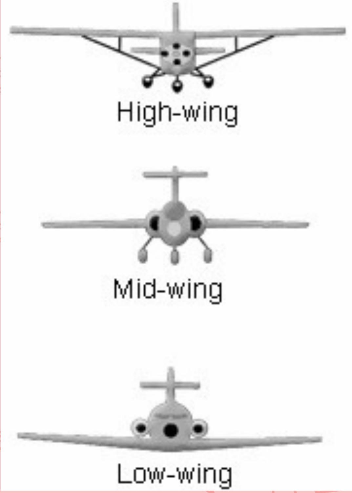

High wing provides the roll stability!

4.4) Aspect ratio -

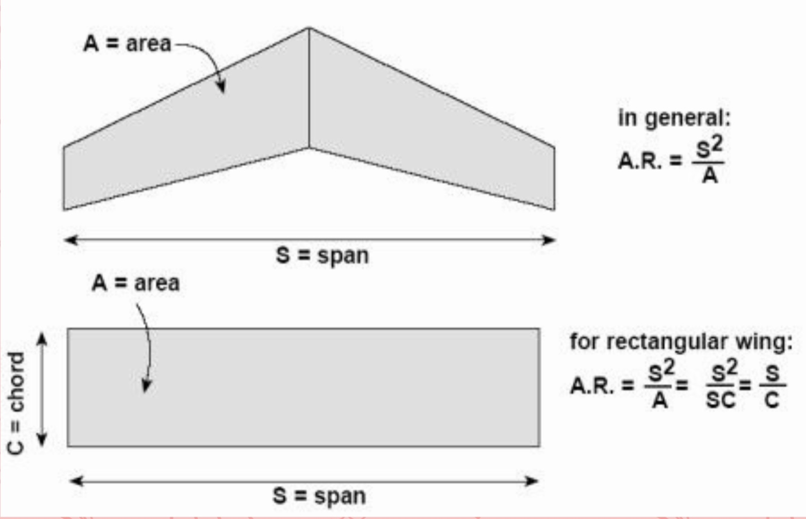

Higher AR → Better performance, better stability, but also leads to wing bending.

Lower AR → Great for structure, better maneuverability, but increases drag.

## Journal 5 — Planning  the power

Time spent : 45 minutes

Considering the parts I already had, the electronics I finalized were

two 1400 kV motors with 7x4 props, both spinning in opposite directions so that their torque cancels.

Two 30 A ESCs on a single throttle channel through a Y lead.

The two ESCs were soldered in parallel, which was powered by one 3S battery.

## Journal 6 — material preperation

Time spent : 1 hour 50 minutes

I am adding a list of materials required, I had most of them, rest were bought online

2 Depron sheets, 100 × 65 cm (about 3 mm thick)

Packing tape , electrical tape , duct tape

6 mm carbon rod, 100 cm

2 × 1400 kV brushless motors with X-mounts and prop adapters

7×4 props, one normal and one reversed ("R"), plus spares of each

2 × 30 A ESCs, a parallel battery lead, a 3S 1300 mAh LiPo and charger

Transmitter and receiver (4 channels or more), 2 servo Y-leads

3 × 9 g servos with arms, 3 control horns

About 60 cm of 1 mm steel wire (pushrods) and 30 cm of 2 mm steel wire (landing gear)

3 mm plywood scraps (2 motor plates, 1 gear plate), M3 bolts and nuts

Bamboo skewers, 4 rubber bands, velcro, small zip ties, popsicle sticks

hot glue sticks

Tools

Snap-off cutter with fresh blades, 100 cm steel ruler, set square, pencil, cutting mat,glue gun, 120 and 240 sandpaper, pliers, wire cutter, vice, drill (3, 8 and 10 mm), kitchen scale,

## Journal 7 — Design Calculations

Time spent : 2 Hours 40 minutes

I had depron sheet of 65*100cm, and a one-piece wing avoids a weak joint, so I fixed the span of 100cm

So to pick the wing area from the weight, estimate the all up weight and divide by the wing loading.

I approximated the weight as follows;

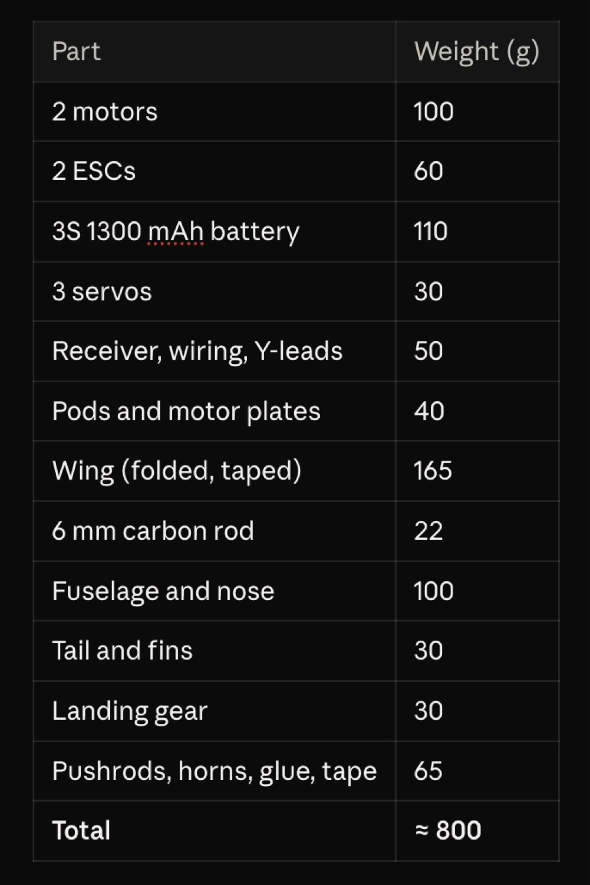

Following the 40 g/dm² trainer wing loading we get the wing area as

Hence the aspect ratio is

The extra thrust from the bi propellor compensates for a little lower aspect ratio

Then I splatted the chord length of 20cm into 15cm + 5 cm for ailerons

The fuselage should be about 0.8 of wingspan so we get a fuselage length of 80 cm

This concludes all the major dimensions I need, the calculations took my patience to its limit but were indeed one of the most important part of this build

This really sets up how smooth a plane fliesss!

## Journal 8 — Drawing the sketch

Time spent : 1 hour 20 minutes

After getting the major dimensions, many rough tries and some wasted sheet of paper, the sketch I finalised is as follows

(Ps: I suck at drawing but I still have that thing were I draw again and again till I like the sketch)

So this was one of my first design, the next ones are improved and drawn after making the calculations

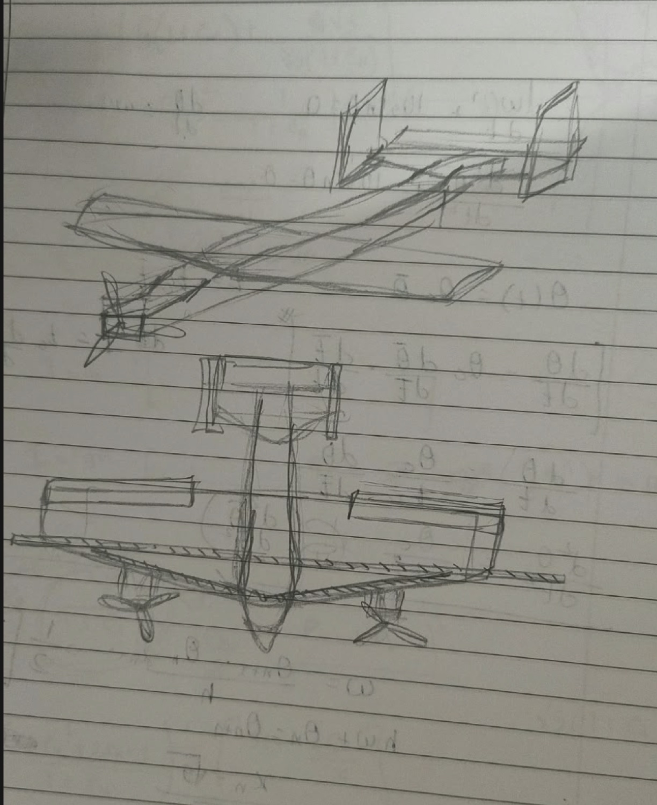

## Journal 9 — THE CAD!

Time spent : 7  hours 40 minutes

After just grinding the final design, matching every dimension and the numbers I found before, the design part is pretty basic, matching every dimension is what takes time.

Over 25 parts in this final build which took me one entire night to complete it, but the grind was worth it!

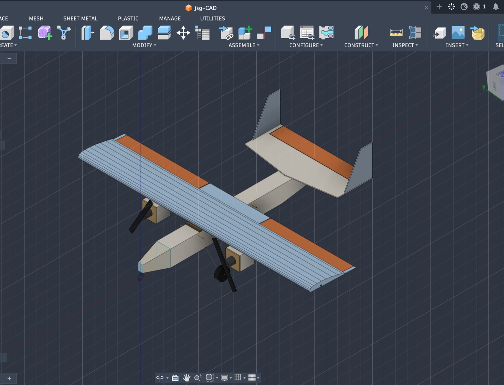

## Journal 10 — Taping, Drawing the parts

Time spent : 2 hours

The first step is to tape the depron from 1 side, it’s a ritual you do before starting! Jokes apart, it helps in cutting the parts without breaking/cracking the depron

I used two  65*100cm depron sheets. Taping two sheets one by one was very slow and one of the most boring parts of the build

Also note that the direction of taping is important as well - very important

The wing sheet was done, so next was the second sheet (the guide calls it sheet B), which is for the fuselage, tail and fins.

Same ritual as before, tape one side completely before cutting anything.

This is the plain sheet before taping

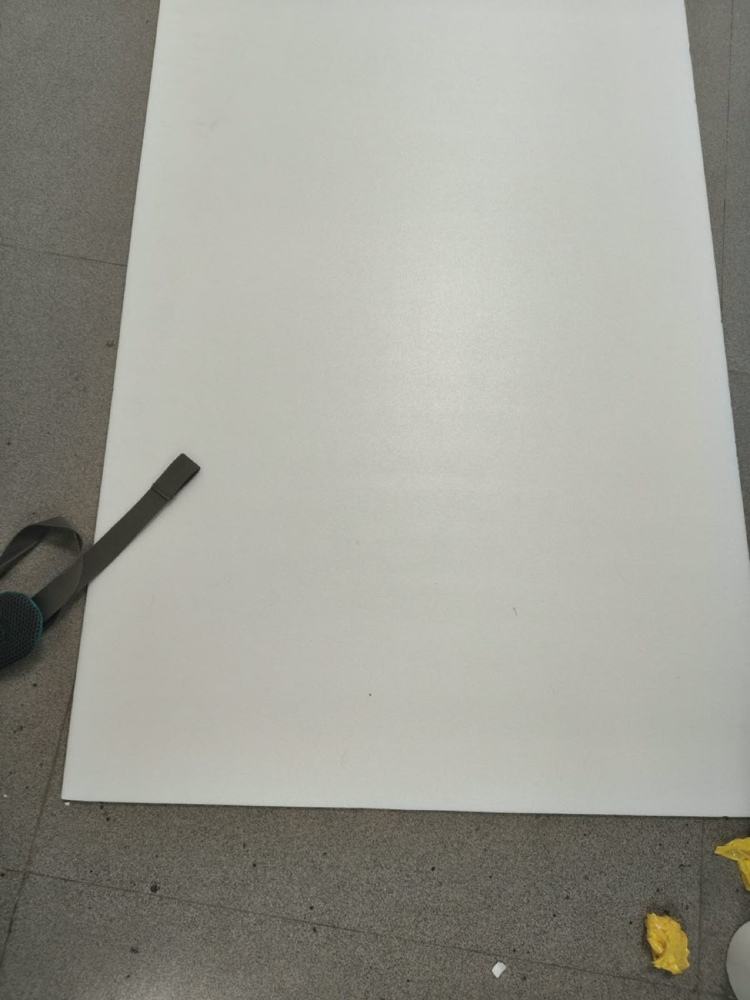

I taped it in strips next to each other and kept pressing each strip down with my hand so there are no bubbles and no gaps

And this is how it looked after, the whole face is black and shiny now

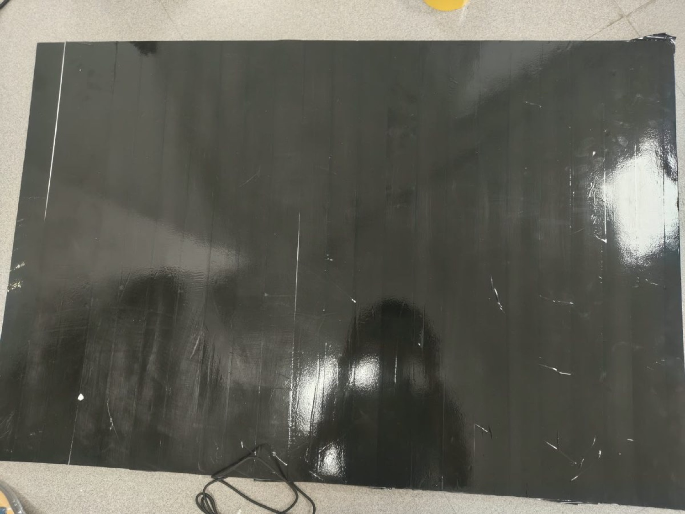

Ps: from now on this sheet always lies taped face DOWN when I draw and cut. The tape ends up on the outside of the plane and it also works as the hinge for every fold later, so this one rule matters a lot.

## Journal 11 — Improved sketches and the plan in my notebook with the NUMBERS!

Time spent : 3 hour 40 minutes

As I said in journal #8, the next sketches were drawn after the calculations. This was the first one with proper numbers on it

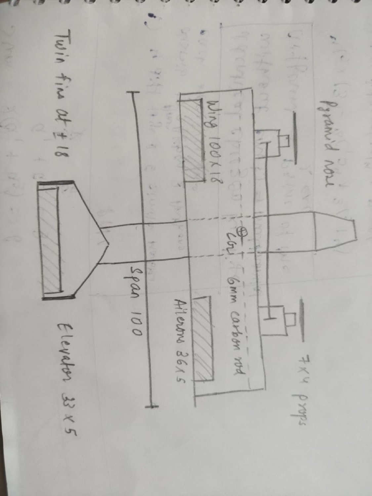

It has the span 100, the two fins, 7x4 props, the 6 mm carbon rod, the pyramid nose and the CG mark. Some of these numbers changed later (the tail got bigger and the fins moved, more on that in journal #14), but this is where it all started.

Next is how I fit the parts on the wing blank. The blank is 100 x 40 and gets folded in half so the chord becomes 20, then two ailerons of 36 x 5 and the spar strips (1 + 2 + 2). The tail and the two pods are also marked next to it

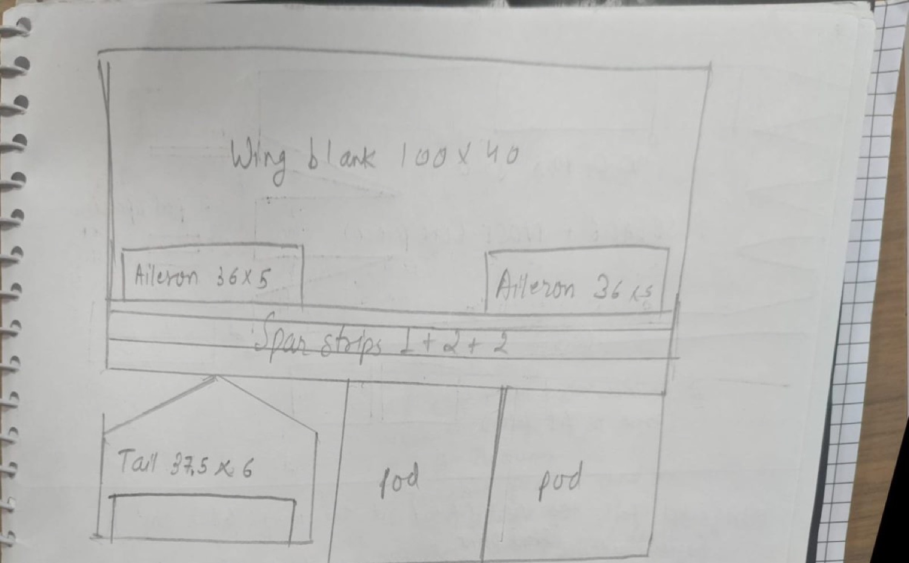

After that I copied the plans of the next steps into my notebook so I can build without the laptop beside me. Right side is the fuselage and nose cone pieces (80.5 long, 26 wide) with the formers, doubler, shim and pod spacers. Middle is the horizontal tail top view, 660 cm². Left is the wing seen from below with the aileron servos, pod spacers and where the ESC and servo leads run

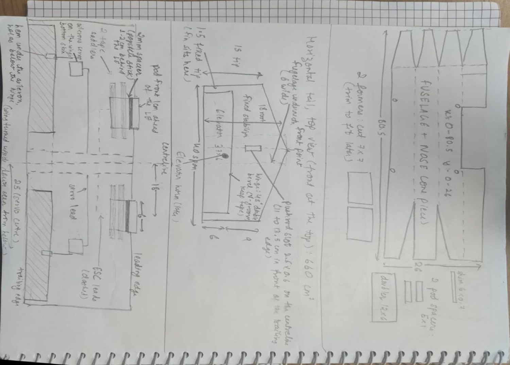

Ps: my handwriting is still bad but at least I can read it :D

## Journal 12 — The wing

Time spent : 3 hours 50 minutes

In my opinion, this was the toughest part of the entire build!

It took me 2 tries to build a neat one, the most delicate part was the bevel cut and folding the wing

The wing is the 100 x 40 blank folded over, so the chord is 20 cm. Out of that 15 cm is the wing and the last 5 cm is the aileron. Spar is the 6 mm carbon rod with the foam strips, and both ailerons are 36 x 5, hinged with the 45 degree V cut which goes down to the tape but never through it.

I also drew a centreline on the bottom of the wing, I use it later to place the pods and to line everything up.

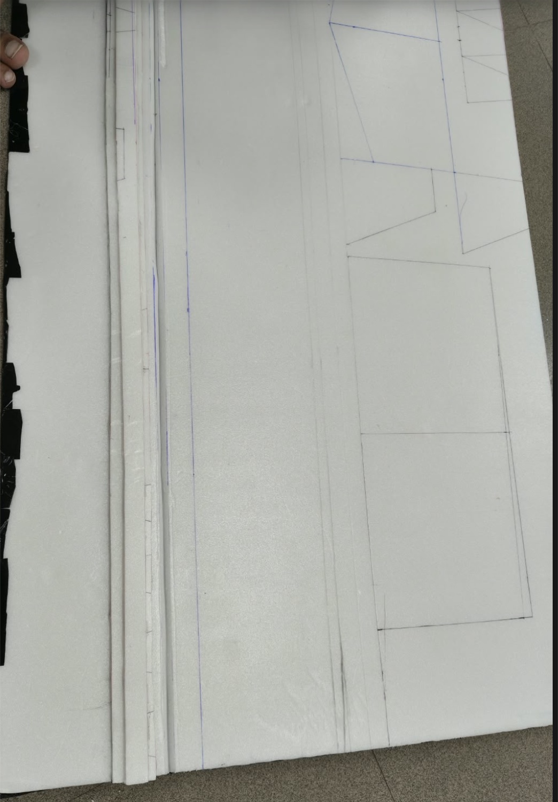

So  after adding the spars I gotta fold the wing, but I messed it up, which costed me 90 extra minutes to get a new depron, tape it and draw it again

Below is the reference for depron to draw the wing.

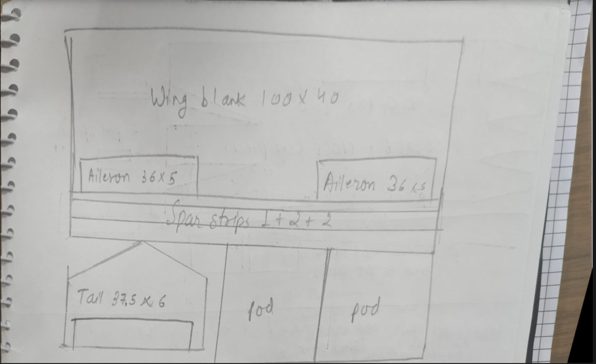

After carefully folding the wing again I wrapped it in blue and green tape in a chevron pattern, the black tape shows in between

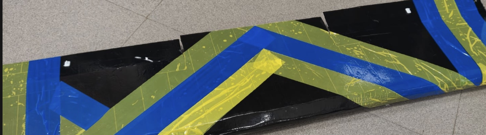

## Journal 13 — adding the servos and control rods

Time spent :  1 hour 50 minutes

The next step after taping the wing was to make the control surfaces THE AILERON actually work

For that I made two slots for servo - this provides the mechanical support and filled the rest space with hot glue gun

Then I added the control rods

NOTE that it is important to place the servo horn just infant of the centre of each aileron, both the servo should be symmetrical about line passing through the centre of wing (mirror symmetry )

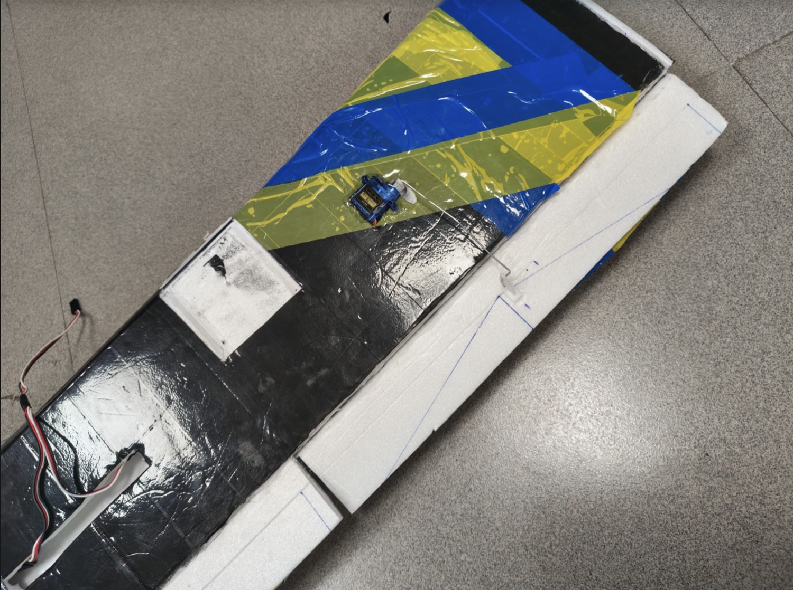

Then I added hooks for control rods and attached them to servo horns

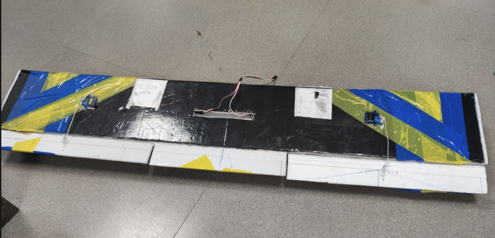

## Journal 14 — THE motor pods

Time spent :  2 hours 50 minutes

After installing the servos I made two motor pods, this was the point when I could actually feel the fun of making a biprop instead of a classic high wing trainer

The cutout from depron was pretty easy to fold

Now to mount the motor I simply drilled M3 holes on 5.5*5.5 balsa wood motor mount (just a piece of square )

Added 2-3 more layers of depron for better support

Anddd stick it with epoxy

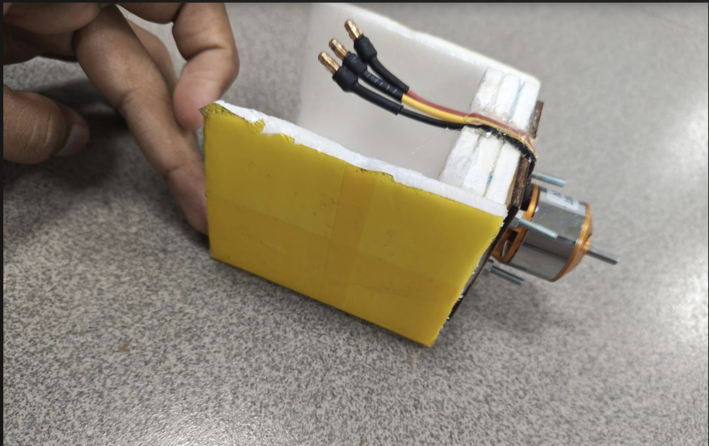

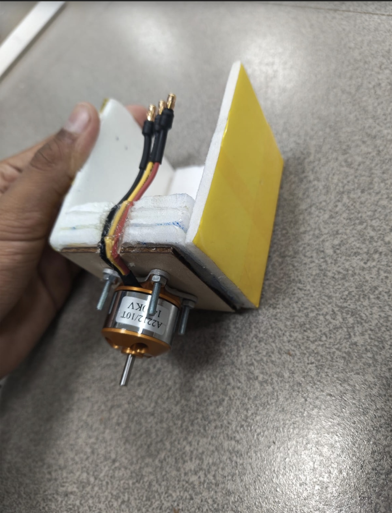

These were my final 2 motor pods

## Journal 15 — Completing the Wing

Time spent : 3 hours 10 minutes

I made two simple winglets out of Depron and glued them on, the main purpose the winglet is to reduce aerodynamic drag but on this small scale it wouldn't matter much.

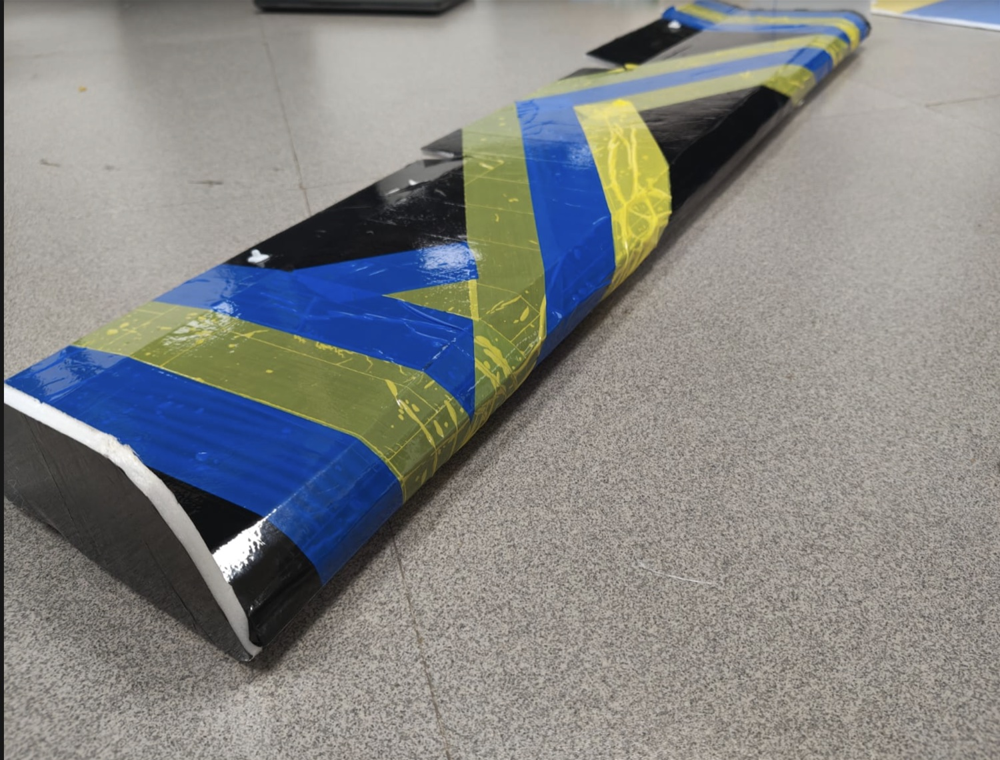

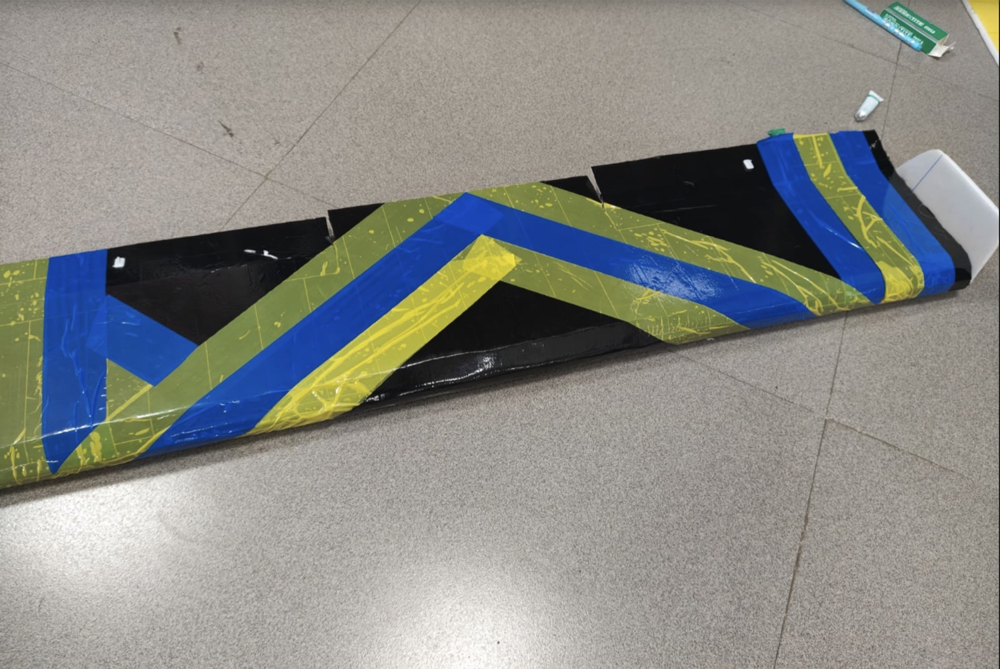

Then I carved two slots for motor pots for mechanical support and filled the slots with epoxy, and fixed the motor pods.

(WARNING- be careful while using epoxy, its a pain if it gets on your skin, I got it on my hand twice just while fixing motor pods)

after adding the motor pods my wing was completed.

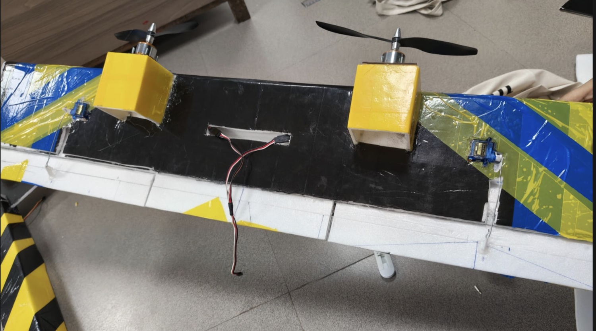

P.S. I carved two more slots since the control rods were rubbing the depron.

## Journal 16 — Fuselage with the pyramid nose

Time spent : 4 hours 35 minutes

Now the fuselage. Everything is cut from one piece of sheet B and the pyramid nose is part of the same piece, so no separate nose to glue.

Station = distance back from the nose tip, I will be using this word from now on.

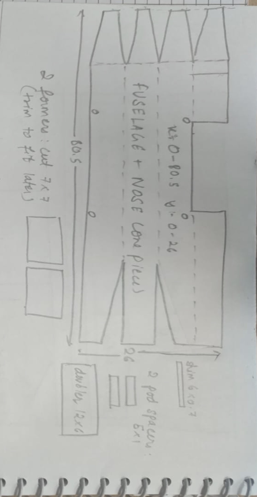

To make the fuselage I started drawing this plan on the depron sheet.

The hardest part of making the fuselage is the dashed lines, which represent the 45° bevel cut on both sides. This helps to fold the fuselage by 90° without the need for any other glue or tape to hold it.

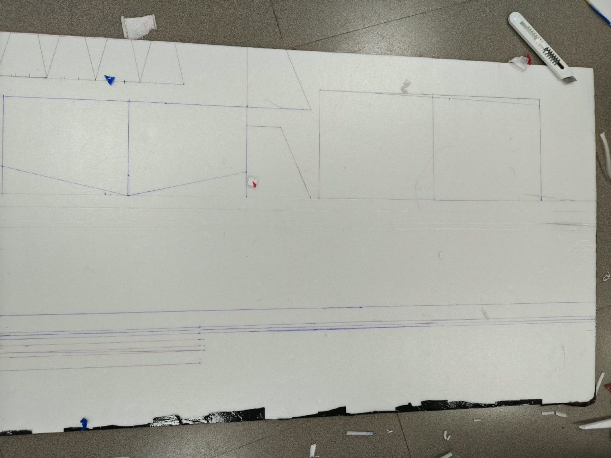

For the bevel cut mark the reference line. Hold the cutter at 45° and after making two to three light cuts, cut the final bevel.

Also the two triangles near the tail makes the tail tapered.

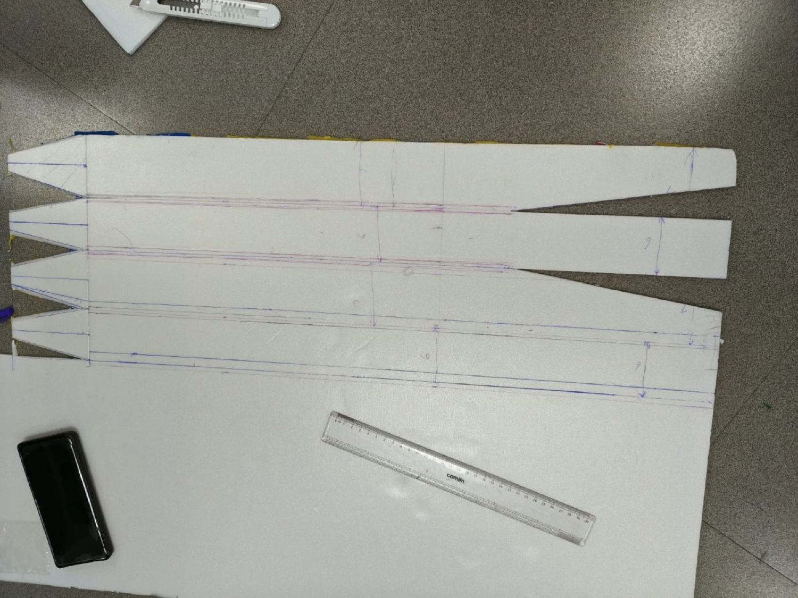

Before gluing anything I folded it dry to check. Every corner closed to a square and the nose closed into a pyramid, which was a relief :D

finally I folded the fuselage and taped it. Also added some design using the tape.

I used the same design of blue and black tapes, which matched my wings.

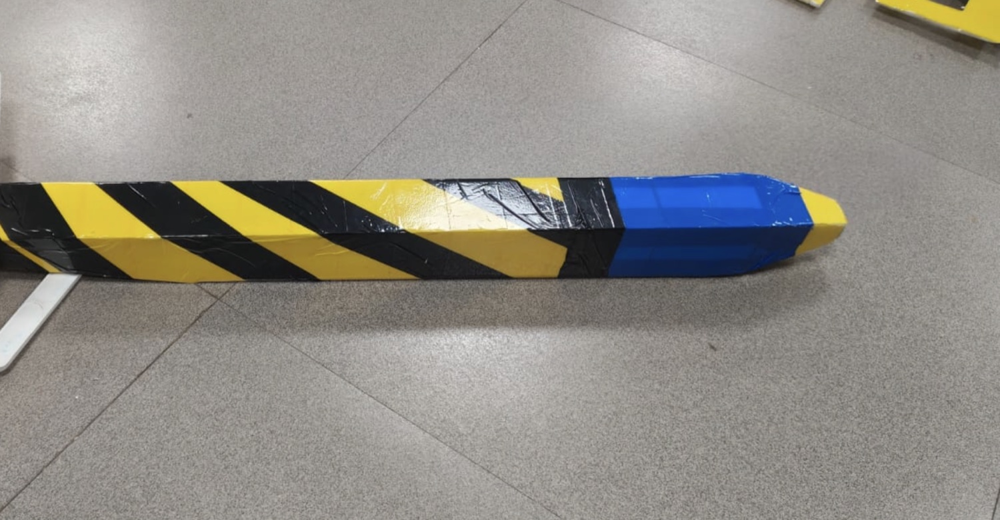

## Journal 17 — Sizing the tail and fins

Time spent : 1 hour 40 minutes

With the fuselage done, I finally knew the tail arm and could size the tail properly. I used the tail volume coefficient method from Raymer (equations 6.26 to 6.29).

My wing has an area of 2000 cm², a mean chord of 20 cm and a span of 100 cm. Its quarter-chord is at station 28 cm. I measured each tail arm from there to the quarter-chord of the horizontal tail or fin.

We picked 0.65 for the horizontal tail and 0.05 for the fins. Raymer gives 0.50 and 0.04 for homebuilts. For comparison, the horizontal value for single-engine GA aircraft is 0.70, and the vertical value for twin-engine GA aircraft is 0.07.

Horizontal tail

I went with a 40 cm span, an 18 cm root chord and a 15 cm tip chord. That gives an average chord of 16.5 cm.

Tail area = 40 × (18 + 15) / 2 = 660 cm²

Tail arm = 67.6 − 28 = 39.6 cm

cHT = (39.6 × 660) / (20 × 2000) ≈ 0.653

My old sketch used a 504 cm² tail based on the rule of thumb from the slides. With the final tail arm, that gives a cHT of about 0.50. The 660 cm² tail gets me much closer to our target of 0.65, so that’s what I went with.

The elevator is 37 × 6 cm, or 222 cm². That’s about 34% of the horizontal tail, close to the 35% suggested in the slides.

Twin fins

Each fin is 13 cm tall, with a 12 cm root chord and a 5 cm tip chord. I used the area of both fins together for the calculation.

Area of one fin = 13 × (12 + 5) / 2 = 110.5 cm²

Area of both fins = 221 cm²

Fin arm = 73.3 − 28 = 45.3 cm

cVT = (45.3 × 221) / (100 × 2000) ≈ 0.050

Both fins point up. The V-22 has fins below the tail too, but on my plane a lower fin would hit the ground before the tail skid. There’s no rudder, so if one motor stops, my plan is to cut the throttle immediately and glide.

The bigger tail adds about 4 g at the back. I expect to move the battery about 1.5 cm forward when I balance the plane. There’s enough room for that.

## Journal 18 — The tail and fins

Time spent : 2 hour 50 minutes

I cut the tail and both fins from sheet B. The tail has a straight trailing edge, and the front edge comes to a point in the middle. Before gluing anything, I stacked the fins to check that their edges lined up.

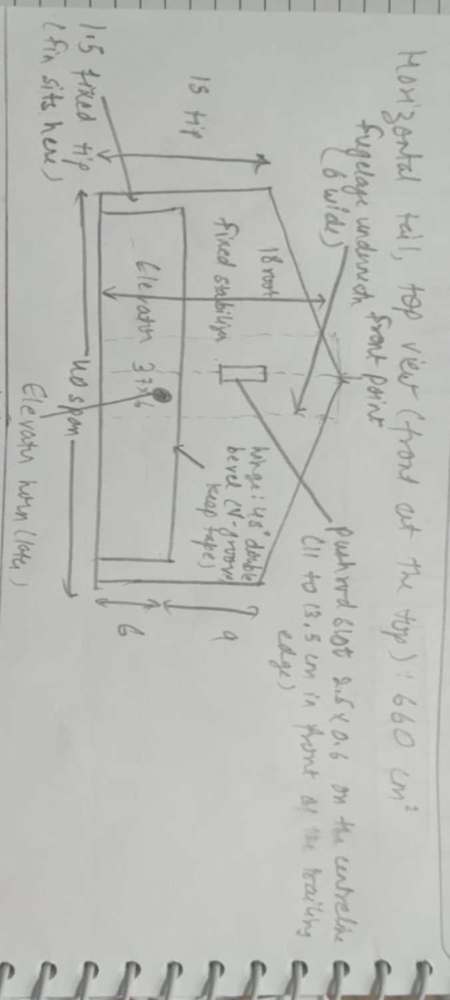

The elevator is 37 × 6 cm. I hinged it the same way as the ailerons, with a 45-degree double bevel down to the hinge tape. I left 1.5 cm fixed at each tip for the fins and cut a small slot in the middle for the pushrod.

I used epoxy to add each fin in the designated place. I used two boxes to hold the fin at 90° while the epoxy was setting up. After, if the epoxy was dried, I taped along both sides to add more support to my fins.

I used the wing as my reference for lining up the tail. I held it on its seat with four rubber bands and measured from the nose tip to each wingtip. Once the two measurements were within 2 mm of each other, I marked the wing’s position on the fuselage with a pencil so I could put it back in the same spot.

I checked by dry-fitting the tail to the fuselage, for which I made a slot on the fuselage, aligning the tail's nose with the center. I used epoxy to again permanently fix the tail to my fuselage.

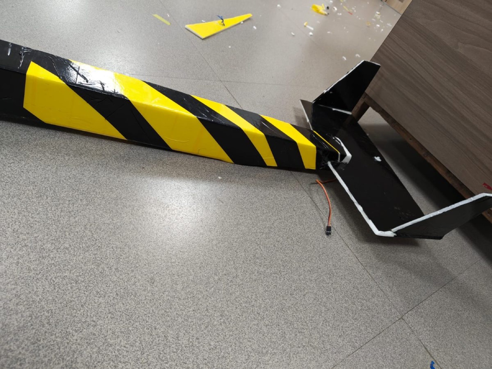

## Journal 16 — Elevator linkage

Time spent : 50 minutes

Two things changed from my earlier notes here. First the pushrod. Going up through a slot on top needs a bent rod and a bent rod flexes, so the elevator wouldn't hold its position. Now the pushrod runs straight out of a slot on the left side to a horn under the elevator. Second, the servo sits under the closed top so I can't reach its arm, so I cut a small access window in the top.

Taped it shut when done, one strip of tape, easy to open again.

Next is to add servo horn and control rods like that on ailerons

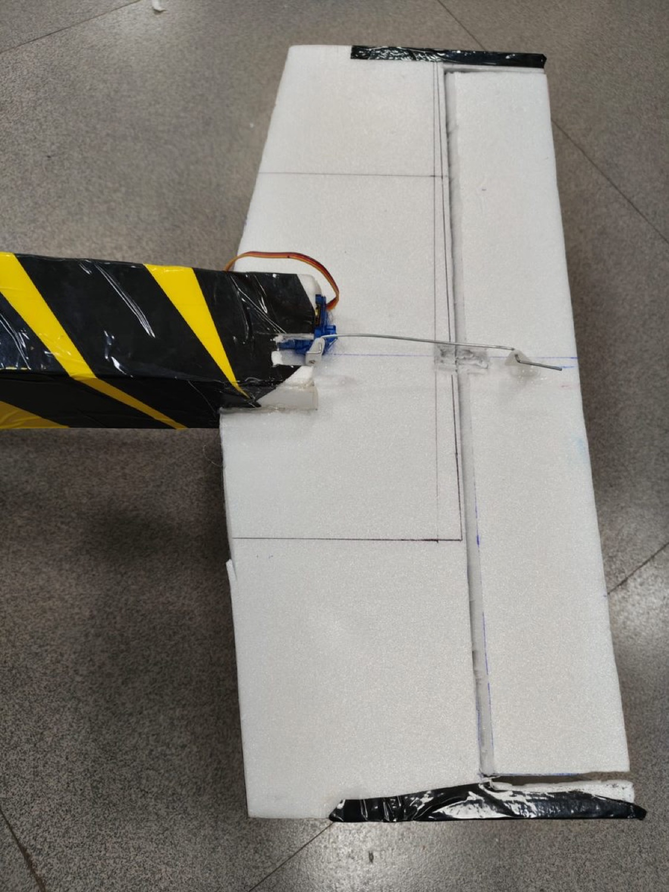

Checks - with the arm pointing down the elevator should be level, it should move smoothly by hand and the rod shouldn't rub on the slot ends. Also taped over the old slots on top of the fuselage and the tail

## Journal 17 — Wiring the ESCs

Time spent : 3 hour 20 minutes

Now the electronics I planned in journal #5 start to get real.

This was a real pain, making it without a power distribution board, soldering those thick 14mm wires took a lot of time and since I blundered while soldering I had to do everything again

I used old and non functional esc to get their wires and arrange them in a line, since the motor pods were away from the fuselage, I need to extend it so that my battery and the ESCs could fit in the power pod in the fuselage.

This was by far the smartest move. I think I used it to reduce my budget since I could not find the extender cables and it was expensive online.

I soldered these small wires one by one, which took a lot of time. Making the Y point at the solder ring took a lot of effort.

Both ESCs share one battery and one throttle channel.

Power - the battery leads of both ESCs are soldered in parallel to one T plug, so one 3S battery feeds both. the ESCs are the red things in the pictures

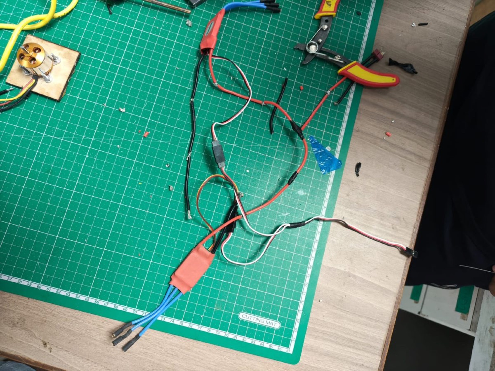

Throttle - both ESCs go on one channel through a Y-lead. On one of the two plugs the red wire is cut and taped over (you can see the red tape on the end), so the two BECs don't fight each other

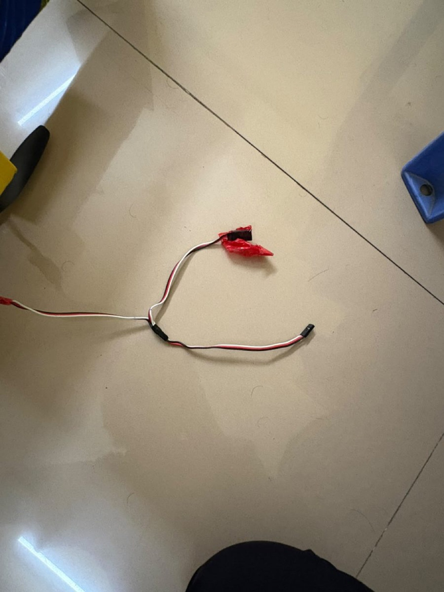

The leads of both pods come along the bottom of the wing and meet in the middle, together with the aileron servo leads

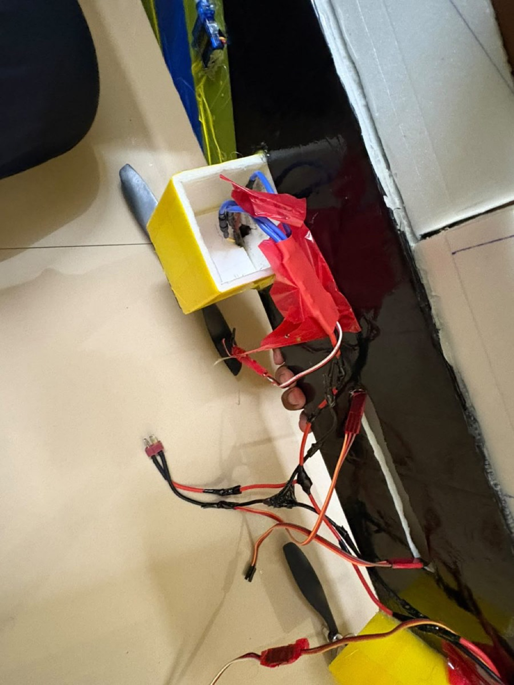

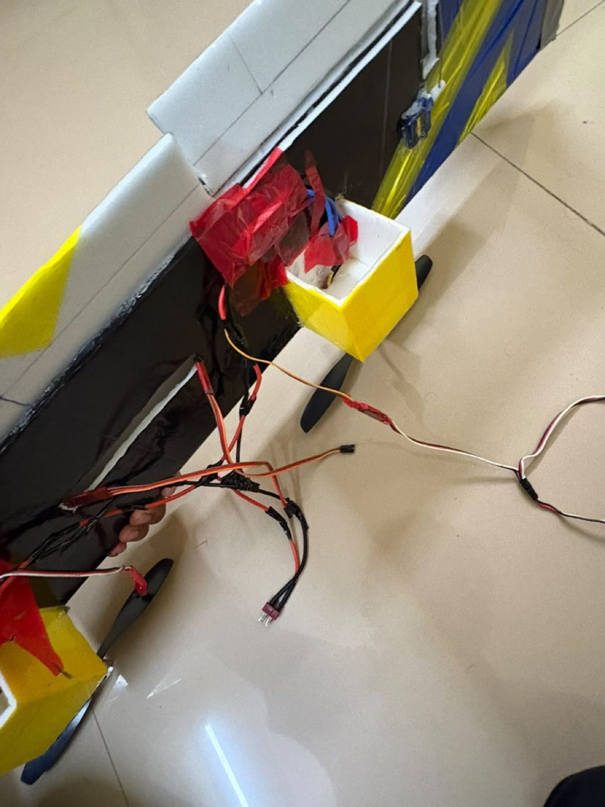

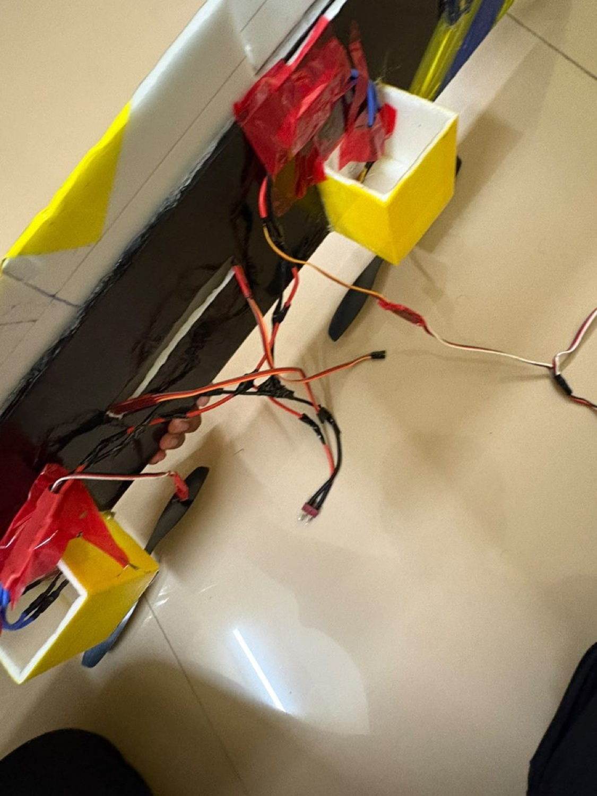

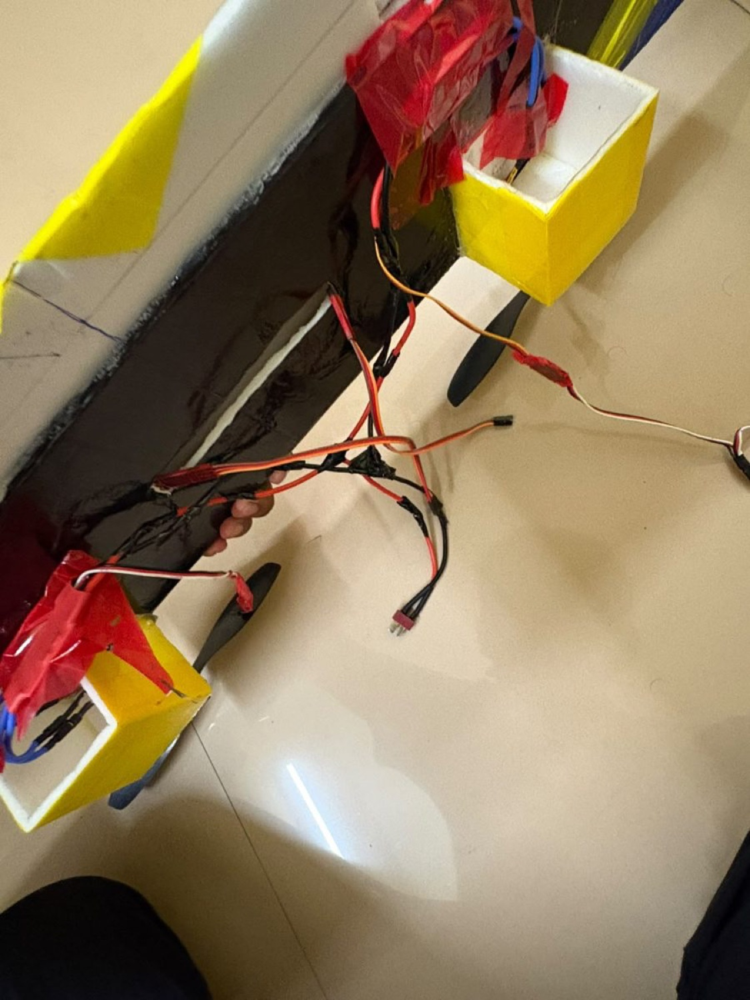

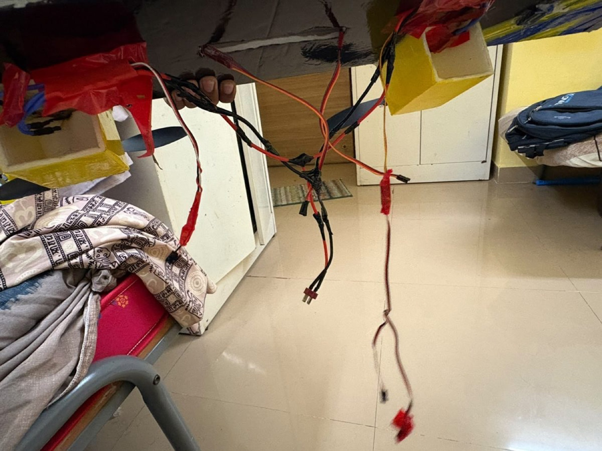

Ps: this part looks like a bowl of noodles right now, I will tidy and tape everything flat later.

## Journal 18 — Wing on the fuselage

Time spent : 30 minutes

Now it is the first time I could see everything together. The wing sits on its seat on the fuselage, the leading edge on the shim and the trailing edge at station 43.

I use ice cream sticks on both sides of the wing and rubber them with the fuselage. Use double the rubber bands for better strength.

The wings and the fuselage are kept separated. I only attach it while flying.

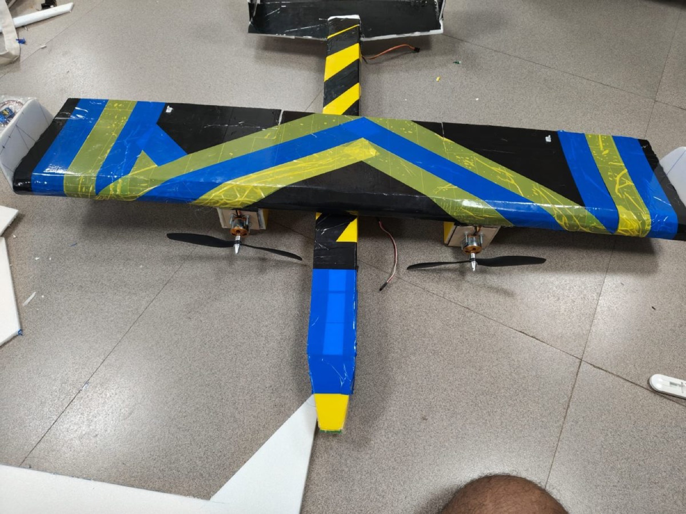

It already looks like a proper plane and not a pile of foam :D

Next is flying!!!!!

## Flight demo

[Watch JetSetGO over the field (15 seconds)](media/jetsetgo-demo.mp4)
