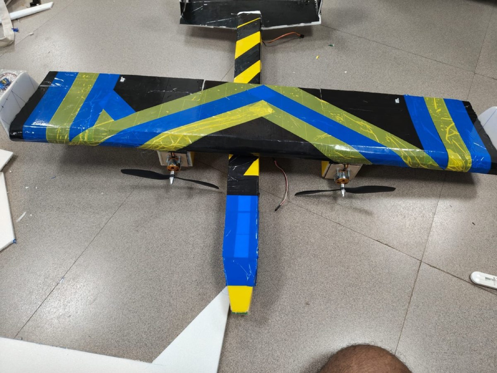

<h1 align="center">

 
JetSetGO!
</h1>

<h3 align="center">A high-wing, twin-motor RC trainer made from Depron, with a motor pod under each wing and twin fins inspired by the V-22 Osprey.</h3>

Total time spent : 56 hours 53 minutes

| Flight demo |
| :---: |
|  |

[Watch the full flight video (15 seconds)](media/jetsetgo-demo.mp4)

## About

JetSetGO is the first RC plane I built for Expedition. I wanted to try a high-wing trainer, but I liked the idea of leaving the nose free and putting a motor under each wing instead. That's how I ended up with two motor pods, a pointed nose and twin fins.

## The build

### Wingspan 100 cm, chord 20 cm (15 cm wing + 5 cm ailerons), fuselage 80 cm

I made the wing by folding a sheet of Depron around a carbon rod. The tricky part was cutting the bevel deep enough to fold the foam while keeping the tape hinge intact. I messed up the first wing and had to start again. The blue and green one in the photo is my second try.

Two servos move the ailerons, and a third moves the elevator. Both motors share one throttle channel. I used rubber bands to hold the wing on so I could take it off between flights.

## Electronics

Two 1400 kV motors with 7x4 props spin in opposite directions so their torque cancels. Two 30 A ESCs are soldered in parallel on one 3S battery and share a single throttle channel through a Y lead.

## BOM

| Part | Qty | Spec | Used for | Notes |
| --- | --- | --- | --- | --- |
| Depron sheet | 2 | 100 x 65 cm (3mm) | whole airframe | tape one side before cutting |
| Carbon rod | 1 | 6mm x 100cm | wing spar | not glued in - slides out |
| Brushless motor | 2 | 1400kV | power pods | came with X mounts + prop adapters |
| Propeller | 2 | 7x4 | motors | one normal one reversed (R) |
| Spare props | 4 | 7x4 | spares | 2 normal 2 reversed |
| ESC | 2 | 30A | motors | red wire pulled out of one plug |
| LiPo battery | 1 | 3S 1300mAh | power | sits in the nose bay on velcro |
| Parallel lead | 1 | XT60 (or whatever your battery has) | battery to both ESCs |  |
| Servo | 3 | 9g micro | 2 ailerons + 1 elevator |  |
| Servo Y-lead | 2 |  | ailerons and ESC throttle |  |
| Transmitter + receiver | 1 | 4ch min | control | CH4 not used |
| Control horn | 3 | small nylon | ailerons + elevator |  |
| Steel wire | 60cm | 1mm | pushrods | Z bends at both ends |
| Steel wire | 30cm | 2mm | landing gear | bent in a vice |
| Wheels | 2 | 50mm | landing gear | with collars |
| Plywood | 1 scrap | 3mm | motor plates (2) + gear plate |  |
| M3 bolts + nuts | 8 |  | motor mounts |  |
| Bamboo skewers | 3 |  | wing band hooks + tail skid |  |
| Rubber bands | 4 |  | holding the wing on | 2 straight 2 crossed |
| Popsicle sticks | 2 |  | pod spacers (downthrust) |  |
| Velcro | 1 strip |  | battery + receiver |  |
| Zip ties | 4 | small | landing gear |  |
| Packing tape | 1 roll |  | taping sheets + pod saddles |  |
| Electrical tape | 1 roll |  | hinges |  |
| Duct tape | 1 roll |  | nose + belly only | heavy so dont overdo it |
| Hot glue sticks | ~15 | low temp | everything | high temp melts depron |
| Sandpaper | 2 | 120 and 240 grit | nose + edges |  |

The full BOM is also in [bom.csv](bom.csv).

## Build journal

[Read the build journal](journal.md) for the sketches, calculations and photos, from my first design to putting the wing on the fuselage.

---
